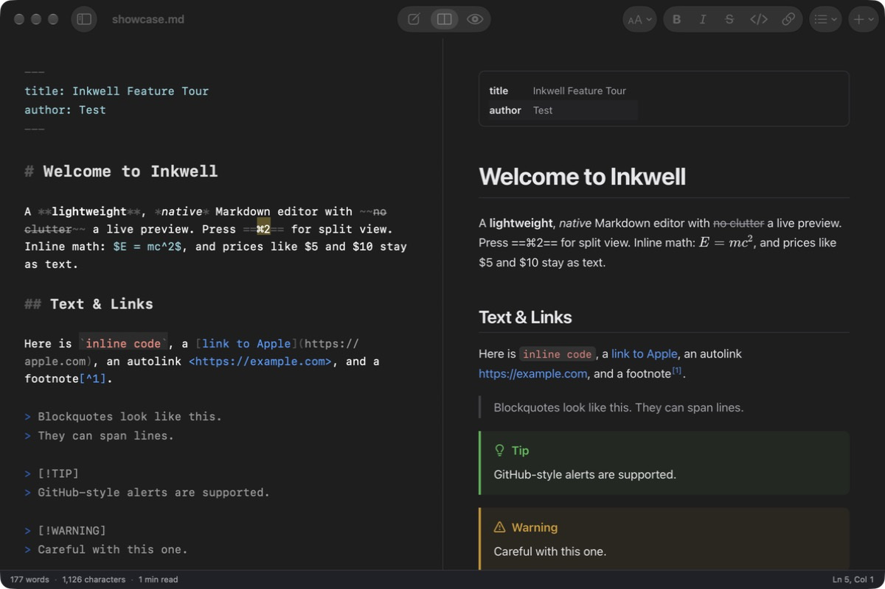

# Inkwell

A lightweight, native Markdown editor and viewer for macOS (SwiftUI + AppKit, ~8 MB, works offline).



## Features

- **Three views:** Editor, Split (live preview), or Preview only. Switch with ⌘1 / ⌘2 / ⌘3.
- **Syntax-highlighted editor:** headings, emphasis, links, code, and lists are styled as you type, and the Markdown symbols are dimmed.
- **Polished preview:** GitHub-flavored Markdown with tables, task lists, footnotes, `> [!NOTE]` alerts, front matter, and ==highlights==.
- **Code highlighting** for about 40 languages, with a Copy button on each code block.
- **Math** via KaTeX: `$inline$` and `$$display$$`.
- **Diagrams** via Mermaid (in a ```` ```mermaid ```` block).
- **Clickable checkboxes:** ticking a task in the preview updates the Markdown source.
- **Folder sidebar (file tree):** opening a file shows its enclosing folder, IDE-style, with the file highlighted. Click any Markdown file to open it in a new tab (or a new window; see Settings). You can make any parent folder the root from the folder name menu, or open any folder (⇧⌘O). The tree updates live as files change on disk, and "Show All Files" reveals non-Markdown files too.
- **New files and folders:** use the **+** button, the right-click menu, or the File menu:
  - New File in Folder… (⌥⌘N) creates the file in the selected folder, or alongside the current document.
  - New Folder… (⇧⌘N).
  - New File in Another Location… (⌥⇧⌘N) opens a Finder save dialog so you can put it anywhere.
- **File management:** right-click to rename, reveal in Finder, copy the path, or move to Trash.
- **Outline:** the sidebar's Outline tab (⌃⌘2) jumps to any heading. ⌃⌘1 shows Files, and ⌃⌘S toggles the sidebar.
- **Scroll sync** between the editor and the preview.
- **Smart editing:** Return continues lists, quotes, and task lists, and Return on an empty item ends the list. Tab / ⇧Tab indent and outdent list items. Typing `*`, `_`, `` ` ``, `~`, `(`, or `[` with text selected wraps the selection. Pasting a URL over selected text makes a link.
- **Drag and drop** files or images into the editor to insert links with relative paths.
- **Export** to HTML (⇧⌘E) or PDF (⌥⌘E), Print (⌘P), and Copy as HTML (⌥⇧⌘C).
- **Find and replace** (⌘F), word count, reading time, and cursor position.
- **Light and dark mode**, plus a choice of editor and preview fonts, sizes, and widths. Zoom with ⌘= / ⌘- / ⌘0.
- **Auto-save**, version history (File → Revert To), and automatic reload when the file changes on disk.

## Formatting shortcuts

| Action | Shortcut |
| --- | --- |
| Bold / Italic | ⌘B / ⌘I |
| Strikethrough / Highlight | ⇧⌘X / ⇧⌘H |
| Inline code | ⌃` |
| Link / Image | ⌘K / ⇧⌘K |
| Heading 1–6 / Paragraph | ⌥⌘1–6 / ⌥⌘0 |
| Bulleted / Numbered / Task list | ⇧⌘8 / ⇧⌘7 / ⇧⌘9 |
| Quote | ⇧⌘' |
| Code block / Table / Rule | ⌥⌘C / ⌥⌘T / ⌥⌘- |

## Building

```bash
./build.sh           # builds build/Inkwell.app (universal binary)
./build.sh install   # also installs it to /Applications
```

The only requirement is Xcode's command-line tools. The rendering libraries (marked, highlight.js, KaTeX, Mermaid, DOMPurify) are bundled in `Resources/preview/vendor`.

## Requirements

macOS 14 or later. The app is ad-hoc signed, so a copy built on another Mac may need right-click → Open the first time.

## Security

The preview sanitizes all HTML with DOMPurify and enforces a strict Content Security Policy, so a downloaded `.md` file can't run scripts. Links to non-Markdown local files are revealed in Finder rather than opened.

## License

Inkwell is released under the MIT License. The bundled rendering libraries keep their own licenses (MIT, BSD-3-Clause, Apache-2.0/MPL-2.0); you'll find them in [`Resources/preview/vendor/licenses`](Resources/preview/vendor/licenses).
